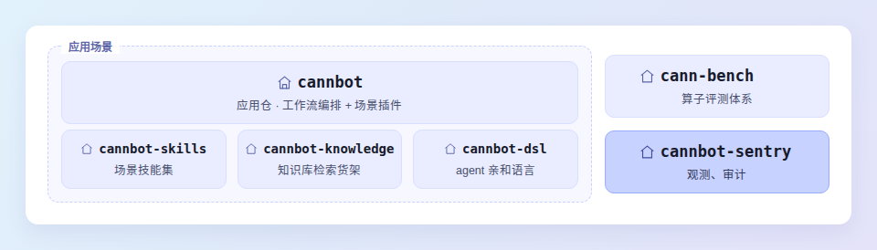

# CANNBot-Sentry


**[中文文档](README-zh.md)**

**CANNBot** is the infra agent layer of the [CANN](https://hiascend.com/software/cann) community — agents for operator development in AscendC/PyPTO/TileLang/Triton and other languages, model migration and inference optimization, extending to more CANN development scenarios such as graph mode and Runtime.

This repo (cannbot-sentry) is its observability repo, providing **Observation · Audit · Evaluation** for LLM coding agents (opencode / Claude Code). The group also includes [cannbot](https://gitcode.com/cann/cannbot), [cannbot-skills](https://gitcode.com/cann/cannbot-skills), [cannbot-knowledge](https://gitcode.com/cann/cannbot-knowledge), [cannbot-dsl](https://gitcode.com/cann/cannbot-dsl) and [cann-bench](https://gitcode.com/cann/cann-bench), as mapped below.



While agents run on the field, Sentry stands on the sideline: **recording what happened, replaying the facts, and judging the quality**.

> Status: `packages/insight` and `packages/cpx` have landed and are published on npm; `packages/sift` (Audit / Evaluate) is planned and not yet migrated. See [Directory Structure](#directory-structure).

## Core Capabilities

| Capability | Question Answered | Highlights |
|-----------|-------------------|-----------|
| **Observe** (packages/insight) | What happened during a run? | Full profile: tokens, cost, context; Turn / Tool / Skill replayable timeline; forensic file-scene rebuild by timestamp |
| **Capture** (packages/cpx) | What went over the wire? | Gateway bypass-captures full-context LLM requests/responses; API keys never touch disk (masked at the single write chokepoint) |
| **Audit** (packages/sift) | Was the declaration followed? | Dual verification: process compliance + result consistency; reconciles execution vs. declared Skill / Agent / Workflow, with evidence back-links |
| **Evaluate** (packages/sift) | Was it done well? | Static analysis + security review (rule-driven); dynamic A/B (with/without Skill, version comparison); verdict reports + CI gates |

**Principles**: non-intrusive — never modifies agent workflows or opencode / Claude Code themselves; local-first — reads local session records only, data never leaves your machine.

**Multi-user ready**: several engineers on one server can each run an isolated instance — per-user fixed port, data/credentials isolated by HOME, capture auto-import never crosses users (`packages/insight/docs/multi-user-server.md`).

## Source Download

```bash
git clone https://gitcode.com/cann/cannbot-sentry.git
cd cannbot-sentry
```

## Installation

**npm (no source clone)** — published packages install straight from the public npm registry:

```bash
npm install -g cannbot-insight   # insight Web UI (cannbot-insight / cbi)
npm install -g cannbot-proxy     # cpx capture proxy (cpx)
# Same tools under the Context brand (session data fully interops):
npm install -g context-insight   # insight Web UI (context-insight / ctxi)
npm install -g context-cpx       # cpx capture proxy (cpx)
```

Shell tab completion is configured automatically on install (bash/zsh); open a new terminal and `cpx <TAB>` just works.

**From source** — the unified installer supports installing a **single package**, a **combination**, or **all**:

```bash
./install.sh insight   # single package
./install.sh insight cpx  # combination
./install.sh all       # everything
```

> `insight` and `cpx` are installable now; `sift` stays a placeholder until it lands. See each package's README for per-package requirements.

## Directory Structure

Monorepo, one directory under `packages/` = one independently installable package. Packages share zero imports and zero build-time dependencies; they couple only through runtime contracts (data formats, CLI interfaces).

```
cannbot-sentry/
├── README.md / README-zh.md   # Bilingual overview, navigation & install
├── LICENSE                    # CANN OSL 2.0, repo-wide
├── CONTRIBUTING.md            # Contribution guide (Issue / PR conventions)
├── SECURITY.md                # Security statement
├── OAT.xml / .gitignore       # Compliance scan / ignore rules
├── install.sh                 # Unified installer: single / combo / all
├── scripts/                   # Governance scripts (license gate, etc.)
├── docs/                      # Cross-package docs (architecture, installation)
└── packages/
    ├── insight/               # Session observability (Observe)
    ├── cpx/                   # Gateway, traffic capture (Capture)
    └── sift/                  # Audit & evaluation (Audit / Evaluate)
```

Extending Sentry = adding a new package under `packages/`, plug-and-play.

## Contributing

Issues and PRs are welcome. See [CONTRIBUTING.md](CONTRIBUTING.md) for the contribution workflow, Issue/PR conventions, and quality gates.

## Security

See [SECURITY.md](SECURITY.md) for the security statement (public URL declaration, file permissions, vulnerability reporting).

## Feedback

- [GitCode Issue](https://gitcode.com/cann/cannbot-sentry/issues) — bugs, feature requests, docs
- [CANNBot SIG](https://gitcode.com/cann/community/tree/master/CANN/sigs/cannbot) — governance and project direction

## License

Licensed under the CANN Open Software License v2.0. See [LICENSE](LICENSE).
